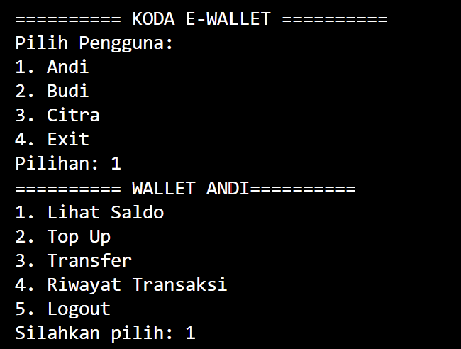
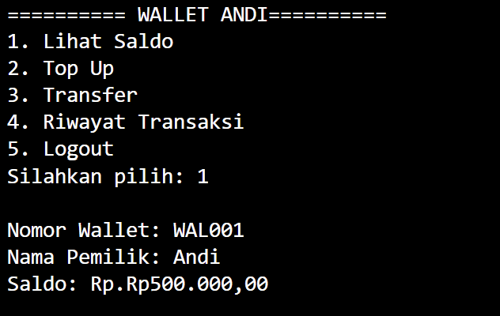
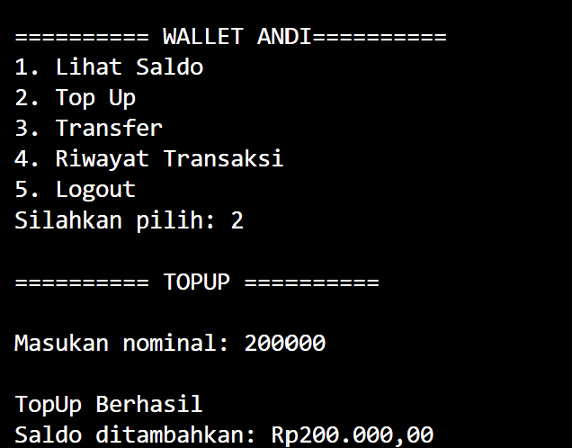
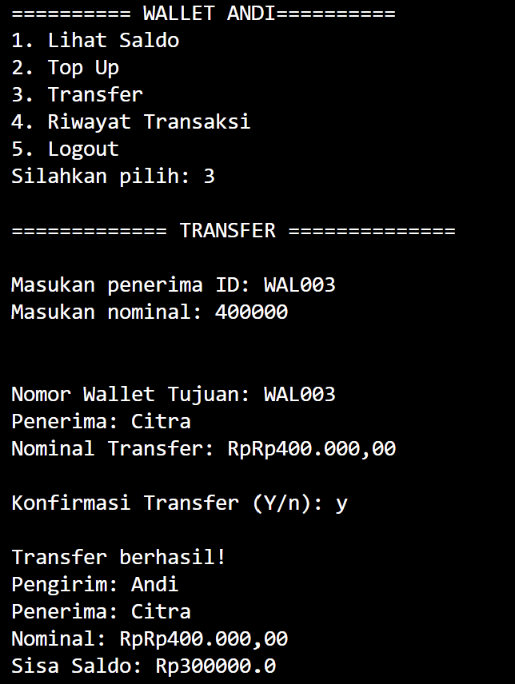
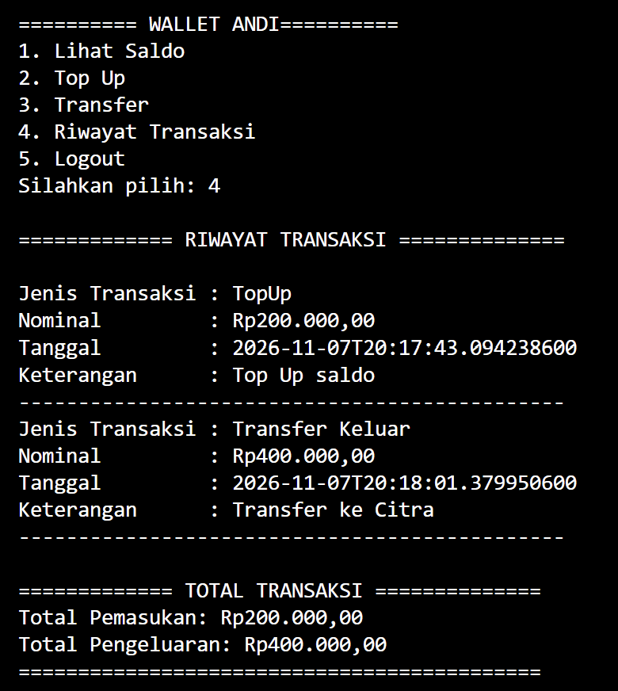

# E-Wallet Console Application (Java & C#)

### Fitur Aplikasi
- Menampilkan daftar pengguna dan wallet.
- Melihat informasi dan saldo wallet.
- Melakukan Top Up saldo.
- Melakukan Transfer saldo antar pengguna.
- Menampilkan riwayat transaksi.
- Menghitung total pemasukan dan pengeluaran.
- Melakukan validasi transaksi dan saldo.

## 2. Alur Aplikasi

1. Aplikasi dijalankan.
2. Pengguna memilih wallet berdasarkan Account Wallet.
3. Sistem menampilkan informasi menu Lihat saldo, TopUp wallet, transfer dan riwayat transaksi.
4. Pengguna memilih transaksi.
5. Pengguna dapat melakukan transaksi berupa:
   - Top Up untuk menambahkan saldo.
   - Transfer untuk mengirim saldo ke pengguna lain.
   - Riwayat untuk melihat transaksi.
6. Sistem melakukan validasi transaksi.
7. Jika transaksi berhasil, saldo wallet diperbarui dan riwayat transaksi disimpan.
8. Pengguna dapat kembali ke menu utama atau keluar dari aplikasi.

## 2. Struktur Class

### Java

```text
src/main/java/com/ewallet/
│
├── App.java
│
├── Models/
│   ├── User.java
│   ├── Wallet.java
│   ├── Transaction.java
│   └── Riwayat.java
│
├── Services/
|   ├── MenuServices.java 
│   ├── TopUpServices.java
|   ├── UserServices.java
│   ├── TransferServices.java
│   └── RiwayatServices.java
│
└── Interfaces/
    └── ITransactionable.java
```

### .NET

```text
EwalletApp.Console/
│
├── Program.cs
│
├── Models/
│   ├── User.cs
│   ├── Wallet.cs
│   ├── Transaction.cs
│   └── Riwayat.cs
│
├── Services/
│   ├── MenuServices.cs 
│   ├── TopUpServices.cs
|   ├── UserServices.cs
│   ├── TransferServices.cs
│   └── RiwayatServices.cs
│
└── Interfaces/
    └── ITransaction.cs
```

## 4. Penerapan OOP

### Encapsulation
---
Encapsulation diterapkan dengan menggunakan access modifier private pada atribut dan menyediakan getter serta method untuk mengakses atau mengubah data.

.Net = private set (pengelolaan saldo wallet).
Java = private state atau field

### Inheritance
---

class turunan yang diwarisi dari class Induk.

(Transaction)
- TopUpServices
- TransferServices

(User)
- Wallet

### Abstraction
---
Abstract class Transaction yang mendefinisikan method transaksi yang harus diimplementasikan oleh class turunannya.

### Polymorphism
---
Polymorphism diterapkan melalui penggunaan method yang sama dengan implementasi berbeda pada setiap jenis transaksi.

Contohnya:
- Top Up
- Transfer

### Interface
---
Interface digunakan untuk menentukan kontrak method yang harus diimplementasikan oleh class terkait transaksi.

## 5. Cara Menjalankan Aplikasi

### Java
---

**Persyaratan:**
- JDK 17 atau versi yang lebih baru.
- Apache Maven.

**Langkah menjalankan:**

Masuk ke direktori project Java:

```bash
cd koda-b1-weekly4-java
```

Compile project:

```bash
mvn compile
```

Jalankan aplikasi:

```bash
java -cp target/classes com.ewallet.App
```

### C# (.NET)

**Persyaratan:**
- .NET SDK.

Masuk ke direktori project C#:

```bash
cd koda-b1-weekly4/src/EwalletApp.Console
```

Jalankan aplikasi:

```bash
dotnet run
```

## 6. Perbandingan Java dan C# (.NET)

| Aspek | Java | C# (.NET) |
|---|---|---|
| Paradigma | OOP | OOP |
| Tools | Maven | .NET SDK |
| Format | .java | .cs
| API Streaming | stream API | LINQ

## 7. Screenshoot

### Account
---

---

### Menu & Lihat Saldo
---

---

### TopUp
---

---

### Transfer
---

---

### Riwayat
---

---